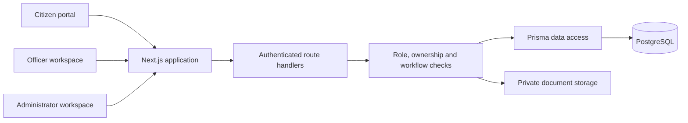
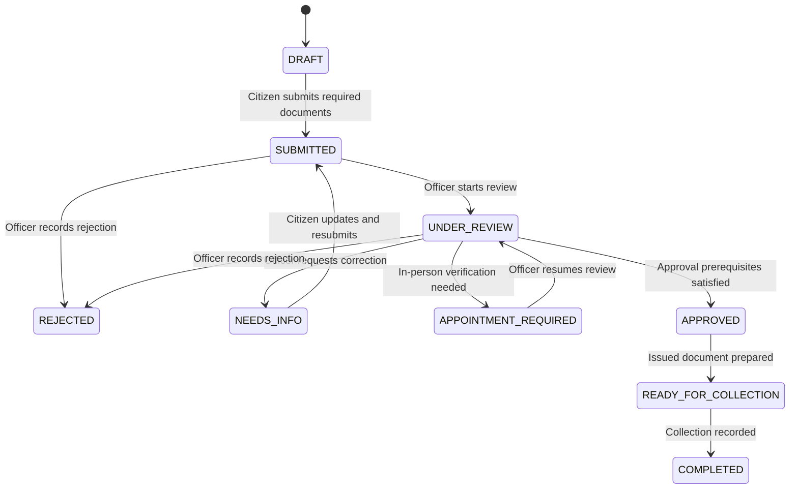

# ConsulEase architecture

ConsulEase implements the proposal's shared citizen portal, officer workspace, and administrator workspace. Next.js and TypeScript provide the interface and HTTP API; Prisma manages a PostgreSQL database. Applications, supporting documents, appointments, fee records, and decisions share the same records across the three roles.

The proposal consistently lists **eight** service entries, although two paragraphs say nine. The implementation follows the explicit list: Passport Renewal, Entry Visa Application, Document Attestation / Notarial Certification, Citizen Registration, Visa Support / Reference Letters, Emergency Travel Document, National ID Card Application, and Community Announcements. Community Announcements is an information and publication module rather than a consular application requiring approval.

## Responsibilities

| Layer | Responsibility |
| --- | --- |
| Next.js interface | Role-specific navigation, forms, service selection, application tracking, document library, appointments, receipts, and staff operations |
| API route handlers | Input validation, cookie authentication, role and object-ownership enforcement, workflow prerequisites, application history, and notifications |
| Prisma / PostgreSQL | Referential integrity, unique user emails and application references, persistent sessions, service configuration, application/document links, slot occupancy, payments, and audit records |
| Private file storage | Original supporting-document bytes, outside publicly served assets; downloads pass through authenticated authorization |
| Setup scripts | Install pinned dependencies, prepare local PostgreSQL, apply Prisma migrations, and seed the development demonstration |

## Roles and access

| Role | Allowed operations |
| --- | --- |
| `CITIZEN` | Register, sign in, update their own profile, upload/reuse/download their own documents, draft/submit their own applications, book/reschedule/cancel their appointments, track decisions, view their fee receipts, read notifications and published announcements |
| `OFFICER` | Review citizen applications/documents, record verification decisions and remarks, manage slots and appointments, check citizens into the queue, record received fees, and advance supported processing stages |
| `ADMIN` | Officer operations plus fee-waiver authorization, service/fee/requirement configuration, staff account administration, announcement publication, dashboard reports, and CSV exports |

Registration always creates a citizen. Staff accounts are created by an administrator. Administrative endpoints and foreign citizen records are protected by server checks; hiding a navigation item does not grant authorization. Disabling a staff account prevents use of its session. The final active administrator cannot be disabled or demoted.

## Data model

| Entity | Purpose and relationships |
| --- | --- |
| User | Profile, email, password hash, role and active flag; owns documents, applications, sessions and notifications |
| Session | Hash of an opaque session token, expiration and user relation |
| Service | Fees, currency, eligibility, procedures, required document categories and appointment/identity/priority configuration |
| Document | Owner, file metadata, private storage identifier and officer review status |
| Application | Unique tracking reference, applicant, service, priority, details, identity verification and fee snapshot |
| ApplicationDocument | Many-to-many link allowing one citizen's documents to be reused in multiple applications |
| ApplicationHistory | Before/after status, actor, timestamp and decision remark |
| Slot / Appointment | Appointment capacity and time, application booking, queue number and attendance status |
| Payment | Recorded fee or waiver, method, reference, receipt number, recording officer and currency |
| Notification | Citizen-specific application and appointment activity with read state |
| Announcement | Administrator-managed community information and publication state |
| AuditLog | Staff and administrative actions used for audit statistics |

Fees are snapshotted when an application is created so later service configuration does not silently change an existing case's charge. Integer fee amounts are denominated in the configured currency; this prototype uses MYR.

## Application processing

Submission checks the configured required categories and attachment ownership. Officer approval requires verified required documents, recorded payment or waiver for a fee-bearing case, and identity/appointment completion when the selected service requires them. Issuance and completion recheck those safeguards. Documents attached to approved or completed cases cannot be reviewed again, preserving decision evidence. Each processing action records a timestamped history entry and informs the citizen. Emergency Travel Document applications support priority processing rather than requiring a separate disconnected system.

Appointment bookings and rescheduling check remaining slot capacity. Concurrent booking requests must not exceed capacity. Cancellation and moving a booking release its former slot. Citizens control their booking, while officers control check-in and completion. The queue number lets staff track attendance.

Payment recording is an officer operation. Cash and bank-transfer records capture payment evidence; a transfer requires a reference. Only an administrator may authorize a waiver, with a recorded reason. A second fee collection on the same application is refused. The citizen and authorized staff can view the receipt. This records payments received by the embassy; it does not charge a card or contact a payment gateway.

## Security and deployment boundary

Passwords use salted scrypt hashes. Password changes require the current password and a strong replacement, revoke all old sessions, and issue a replacement session to the requesting browser. Session tokens use cryptographically random bytes, and only their SHA-256 hashes are stored in PostgreSQL. The session cookie is HTTP-only, uses `SameSite=Lax`, and uses the Secure flag on HTTPS or when secure external-origin configuration is provided. Logout revokes the stored session. API responses omit password hashes. Browser writes reject foreign origins.

Supporting documents accept the configured PDF/image formats and validate their file signatures rather than trusting a filename or submitted MIME type alone. Download requests authorize the owner or staff and serve files as attachments. Database access is parameterized through Prisma.

The local development PostgreSQL process binds to loopback and stores data under the ignored `.data` directory. A deployed installation can use an external PostgreSQL connection through `DATABASE_URL`; it must also preserve private document storage, serve HTTPS, and keep secret environment values outside source control.

This is a functional prototype. In-app notifications are implemented; email/SMS delivery, a live payment gateway, automated document authenticity checks, and biometric hardware integration require separately configured providers or devices. An officer records identity verification performed in person. Service requirements, fees and demonstration records must be reviewed by the embassy before real use. Production operation also needs backup/restore procedures, appropriate retention rules, deployment monitoring and a deployment-specific security review.

## Validation

`tests/api.test.ts` exercises the running HTTP API against PostgreSQL, including registration, unauthorized requests, role escalation, foreign object access, real file upload/download, application prerequisites, concurrent capacity conflicts, concurrent document review versus approval, payment/receipt ownership, decision history, announcements, reports, administrator protection, password changes and session revocation. `tests/e2e` exercises user workflows in Chromium. The API fixtures use unique test citizens and test services; they do not change existing users.

For repeatable commands and the latest execution result, see the project README and `docs/VALIDATION.md`. The acceptance checklist in `docs/UAT.md` requires a human reviewer to record their result; automated checks do not constitute embassy approval.
